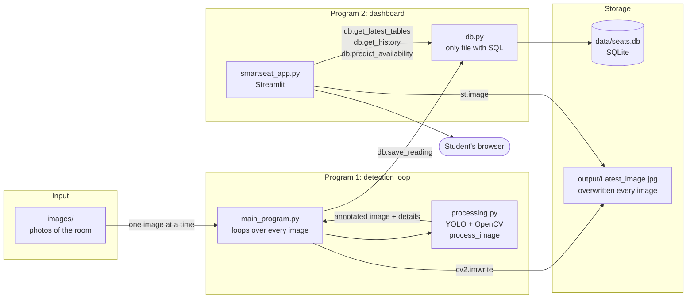
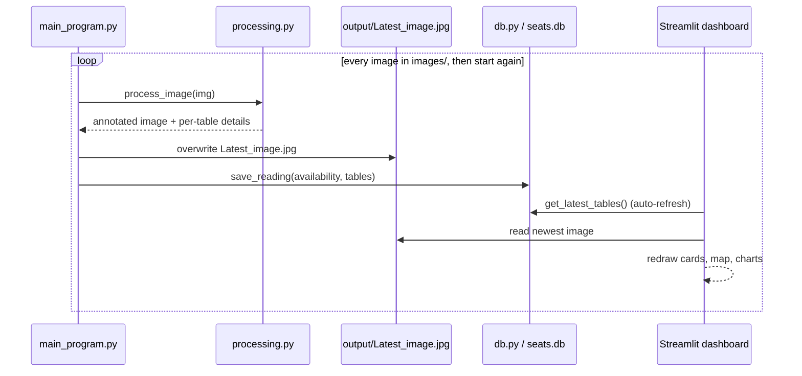
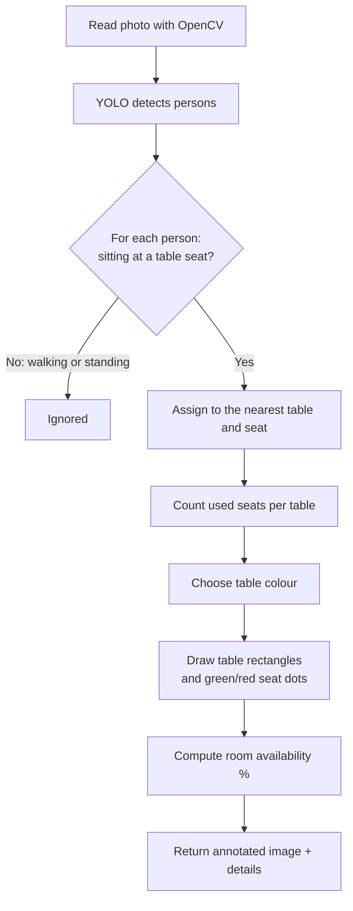
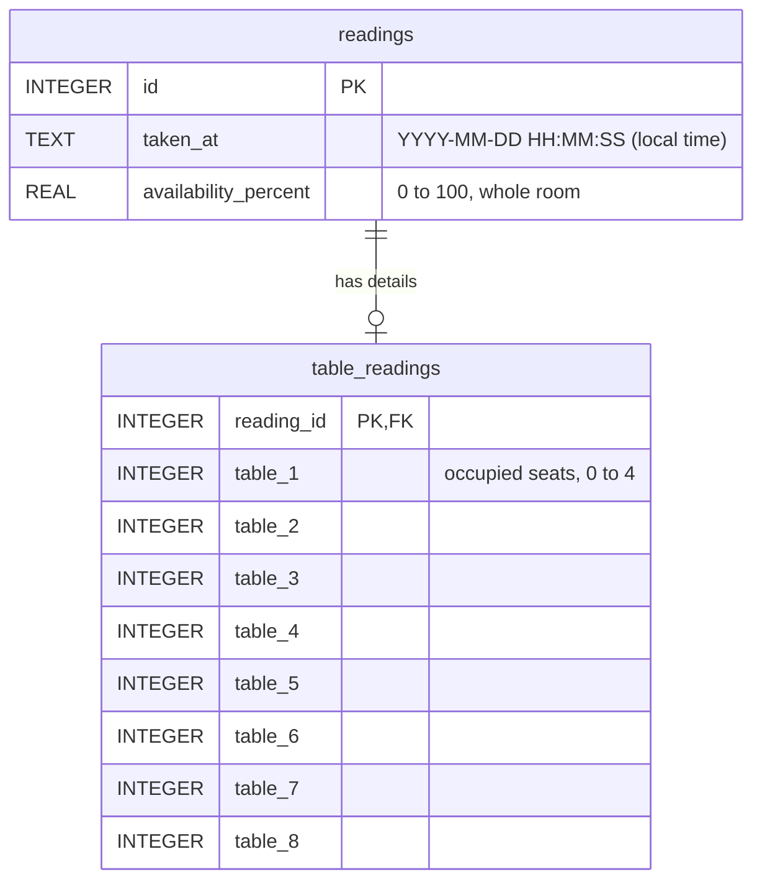
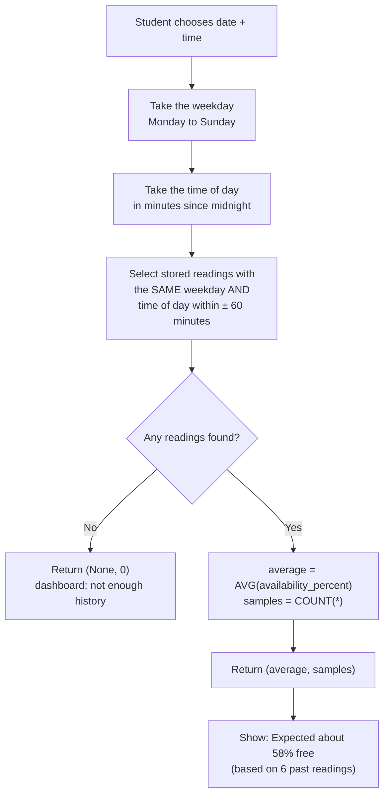

# SmartSeat: Study Room Seat Detector
 
**University of Debrecen · Intelligent study-space monitoring**
 
SmartSeat counts how many seats are **actually used** in a study room, table by table, from photos of the room. It then shows the result on a live dashboard and **predicts how busy the room will be** at a time the student chooses.
 
<p align="center">
  
</p>
---
 
## Table of contents
 
1. [What it does](#1-what-it-does)
2. [Screenshots](#2-screenshots)
3. [System architecture](#3-system-architecture)
4. [Project structure](#4-project-structure)
5. [Detection logic (YOLO + OpenCV)](#5-detection-logic-yolo--opencv)
6. [The loop (`main_program.py`)](#6-the-loop-main_programpy)
7. [Database (`db.py`)](#7-database-dbpy)
8. [Availability prediction ("Find Available Seats")](#8-availability-prediction-find-available-seats)
9. [Dashboard (`smartseat_app.py`)](#9-dashboard-smartseat_apppy)
10. [Installation and running](#10-installation-and-running)
11. [Sharing the dashboard](#11-sharing-the-dashboard)
12. [Demo data and limitations](#12-demo-data-and-limitations)
13. [Tech stack](#13-tech-stack)
---
 
## 1. What it does
 
| Feature | Description |
|---|---|
| **Seat-level detection** | YOLO finds the people in the photo, and only people who are **sitting at a table seat** count. Anyone walking or standing is ignored. |
| **Table-level result** | Each of the 8 tables is outlined with a rectangle: **green** = empty, **orange** = partly occupied, **red** = fully occupied. |
| **Seat markers** | Each seat position is marked **green** (free) or **red** (used). |
| **Live dashboard** | The Streamlit page shows the latest processed image, the numbers for each table and the history, and refreshes by itself. |
| **Find Available Seats** | The student picks a date and time. The app predicts the expected availability from past readings at the same weekday and a nearby time of day. |
| **Privacy** | The database stores **only numbers** (counts and percentages). No faces or people's identities are stored. |
 
---
 
## 2. Screenshots
 
### Live overview: processed image and table monitor
<p align="center">
  
</p>
### Charts: people per table and availability history
<p align="center">
  
</p>
### Find Available Seats (planner)
<p align="center">
  
</p>
### Input photo and processed result
 
| Input (from `images/`) | Output (`output/Latest_image.jpg`) |
|---|---|
|  |  |
 
### Database views
 
| `readings` table | `table_readings` table |
|---|---|
|  |  |
 
---
 
## 3. System architecture
 
The project is **two programs that run side by side** and never block each other. They communicate only through two things: the **output folder** (image) and the **SQLite database** (numbers).
 

 
### One cycle, step by step
 

 
Why two separate programs?
- YOLO is slow (about 2 to 3 seconds per image). If it ran inside Streamlit, the page would freeze.
- SQLite is opened in **WAL mode** with a timeout, so the dashboard can **read while the detector writes**.
- The image is written under the **same fixed name**, so the dashboard always shows the newest result.
---
 
## 4. Project structure
 
```
study-room-seat-detector/
├── main_program.py     # the loop: takes each image, runs detection, saves results
├── processing.py       # process_image(): YOLO + OpenCV detection and drawing
├── db.py               # ALL database code: save, read, history, prediction
├── smartseat_app.py    # Streamlit dashboard
├── style.css           # dashboard styling
├── requirements.txt    # Python packages
├── images/             # input photos (processed in a cycle)
├── models/             # YOLO weights (e.g. yolo11m.pt)
├── output/             # Latest_image.jpg (overwritten after every image)
├── data/seats.db       # SQLite database (created automatically)
└── docs/images/        # screenshots used in this README
```
 
> **Rule:** nobody except `db.py` writes SQL. Everything else calls its functions.
 
---
 
## 5. Detection logic (YOLO + OpenCV)
 
`processing.py` exposes one function:
 
```python
annotated_img, details = process_image(img)
```
 
- `img`: the photo as an OpenCV (BGR) image.
- `annotated_img`: the same photo with rectangles and seat markers drawn on it.
- `details`: the numbers for the database and dashboard, for example:
```python
{
  "availability": 28.1,                       # free seats / total seats * 100, whole room
  "tables": [
      {"table": 1, "occupied": 0},            # occupied seats at table 1
      {"table": 2, "occupied": 2},
      ...
  ]
}
```
 
### Pipeline
 

 
<!-- TODO (team): add the exact parameters used in processing.py: YOLO confidence, how a person is matched to a seat (distance or overlap rule), how the table and seat positions are defined. -->
 
### Table colours and seat markers
 
| Used seats at the table | Table rectangle | Meaning |
|---|---|---|
| 0 of 4 | 🟩 **Green** | Empty |
| 1 to 3 of 4 | 🟧 **Orange** | Partly occupied |
| 4 of 4 | 🟥 **Red** | Fully occupied |
 
| Seat marker | Meaning |
|---|---|
| 🟢 green dot | Free seat |
| 🔴 red dot | Seat used by a seated person |
 
Only **seated** people count. The person walking in the photo below the tables is deliberately **not** counted.
 
### Availability formula
 
For the whole room (8 tables × 4 seats = **32 seats**):
 
```
availability % = free seats ÷ total seats × 100
free seats     = 32 − occupied seats
```
 
Example: 9 occupied seats → (32 − 9) ÷ 32 × 100 = **71.9 % available** (the dashboard shows this as 23 / 32 free seats and 28 % occupancy).
 
---
 
## 6. The loop (`main_program.py`)
 
`main_program.py` is the program you run for detection. It:
 
1. Loads the YOLO model **once**.
2. Goes through every image in `images/` one after another, in a **circle**: image 1, 2, 3, ..., last, then back to image 1.
3. For each image it calls `process_image()`.
4. Overwrites `output/Latest_image.jpg` (same name every time, so there is always one newest image).
5. Calls `db.save_reading(...)` with the availability and the occupied seats of every table.
Because it never stops, the dashboard keeps changing, like a live camera. A pause or a lighter model (for example `yolo11s.pt`) can be used to change the speed.
 
---
 
## 7. Database (`db.py`)
 
`db.py` is the **only** file that touches SQL. The database file is `data/seats.db` and is created automatically.
 
### Tables
 

 
- `readings` has **one row per processed image**: when it was taken and the room availability %.
- `table_readings` has **one row per reading** and **one column per table**, holding the number of occupied seats at that table. A `CHECK` constraint keeps each value between 0 and 4.
- Deleting a reading deletes its table details (`ON DELETE CASCADE`).
- An index on `taken_at` speeds up the history and prediction queries.
### Functions
 
| Function | What it does |
|---|---|
| `init_db()` | Creates both tables and the index if they do not exist. Safe to call many times. Replaces an old table layout if it finds one. |
| `save_reading(availability_percent, tables=None, taken_at=None)` | Inserts one row in `readings` (time = now unless given) and, if `tables` is given, one row in `table_readings`. Rejects percentages outside 0 to 100. Returns the new row id. |
| `get_history(limit=50)` | Returns the latest readings **oldest first** as `[{"taken_at": ..., "availability_percent": ...}]`, ready for a chart. |
| `get_latest_tables()` | Returns the occupied seats of the 8 tables from the **newest** reading, as a list of 8 numbers. Returns `[0]*8` if the database is empty. |
| `predict_availability(date_time)` | Returns `(average_percent, samples)` for the planner. See the next section. |
| `seed_demo()` | Inserts invented readings (3 weeks of history) so the planner and charts can be tested. Run with `python db.py --seed-demo`. |
 
### How reading and writing work together
 
`_connect()` opens SQLite with:
- `PRAGMA journal_mode=WAL`: readers do not block the writer, and the writer does not block readers.
- `timeout=10` and `PRAGMA busy_timeout=10000`: wait up to 10 seconds instead of failing with "database is locked".
- `PRAGMA foreign_keys=ON`: enforces the link between the two tables.
---
 
## 8. Availability prediction ("Find Available Seats")
 
The student chooses a **date and a time**. The app does **not** look for that exact date. It looks at the **pattern**: how busy the room usually is on that weekday at that time of day.
 

 
Technical details (in `db.py`):
 
- **Weekday match:** SQLite's `strftime('%w')` gives Sunday = 0, so the query uses `(strftime('%w') + 6) % 7` to convert it to Python's Monday = 0.
- **Time window:** `ABS(minutes_of_reading − minutes_of_target) <= WINDOW_MINUTES`, where `WINDOW_MINUTES = 60`.
- **Honest output:** it always returns the **number of samples** next to the average, and the dashboard shows it, so the student sees how much data the estimate is based on.
- **Example:** choosing Friday 10:00 averages every Friday reading between 09:00 and 11:00.
---
 
## 9. Dashboard (`smartseat_app.py`)
 
Built with Streamlit. It re-reads the data every few seconds, so it changes by itself while the detector runs.
 
**Overview page**
- KPI cards: people detected, free seats (for example 23 / 32), occupied tables, occupancy %.
- The latest processed image from `output/Latest_image.jpg`.
- **Occupancy monitor:** a schematic map of the 8 tables with a count and dots for each table. The dots are a count meter: the dashboard shows how many seats are used at a table, while the processed image shows which seat.
- Bar chart: people per table.
- Line chart: availability history from `db.get_history()`.
**Find Available Seats page**
- Date and time pickers, then the result of `db.predict_availability()` with the number of past readings it is based on.
Data flow for the numbers: `db.get_latest_tables()` → table counts → KPIs, map and charts. The image is read from `output/Latest_image.jpg` on every refresh.
 
---
 
## 10. Installation and running
 
**1. Install the packages**
 
```bash
pip install -r requirements.txt
```
 
This installs Streamlit and pandas (the dashboard needs only these). For the detection program you also need:
 
```bash
pip install ultralytics opencv-python
```
 
**2. Put your photos in `images/`** (`.jpg`, `.jpeg`, `.png`) and the YOLO weights in `models/`.
 
**3. Run the two programs, each in its own terminal, from the project folder**
 
```bash
# Terminal 1: detection loop (keep it running)
python main_program.py
 
# Terminal 2: dashboard
streamlit run smartseat_app.py
```
 
Open the address Streamlit prints (usually `http://localhost:8501`).
 
**Optional: fill the database with demo history** (for the planner):
 
```bash
python db.py --seed-demo
```
 
---
 
## 11. Sharing the dashboard
 
Detection runs on the laptop, so the live dashboard has to be served **from the laptop**. A normal cloud deployment only copies the files from the repository and cannot see the laptop's changing image and database.
 
- **Same Wi-Fi:** open the *Network URL* that Streamlit prints.
- **Over the internet:** use a tunnel while both programs run:
```bash
cloudflared tunnel --url http://localhost:8501
```
 
  It prints a public `https://...trycloudflare.com` link that shows the live dashboard from the laptop.
 
---
 
## 12. Demo data and limitations
 
- **The history is demo data.** It comes from a small set of photos, replayed in a loop, plus invented readings from `seed_demo()`. The prediction is therefore an **average of demo readings**, not a real study of student behaviour. The dashboard always shows the sample count for this reason.
- **One fixed viewpoint.** The tables and seat positions assume photos taken from the same camera position.
- **Table-level accuracy.** Detection depends on how well YOLO sees people from above. Crowded rooms, bags and occlusion can cause miscounts.
- **Predictions do not know about events.** Exams, holidays and special days are not modelled.
- **No reservations.** SmartSeat only estimates availability. Nothing is booked or held.
---
 
## 13. Tech stack
 
| Part | Technology |
|---|---|
| Detection | Python, **YOLO (Ultralytics)**, **OpenCV** |
| Storage | **SQLite** (WAL mode) |
| Dashboard | **Streamlit**, pandas |
| Styling | Custom CSS |
 
---
 
*SmartSeat · University of Debrecen · prototype with demo data.*
 
