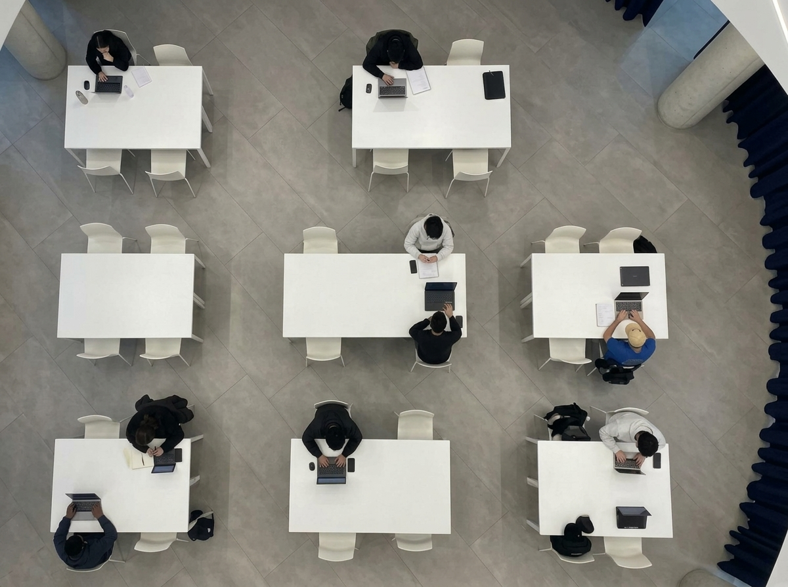
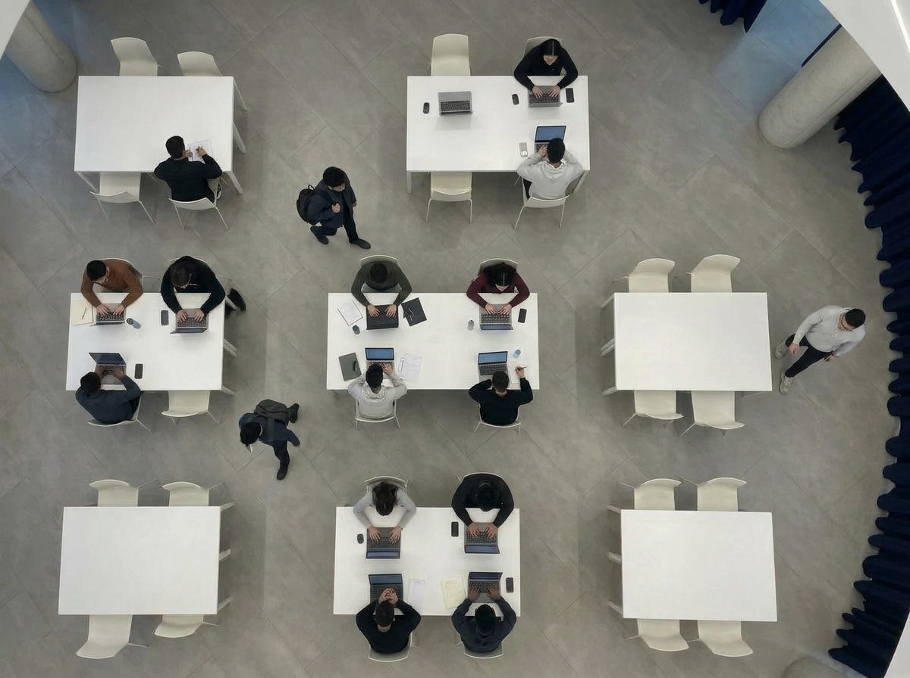
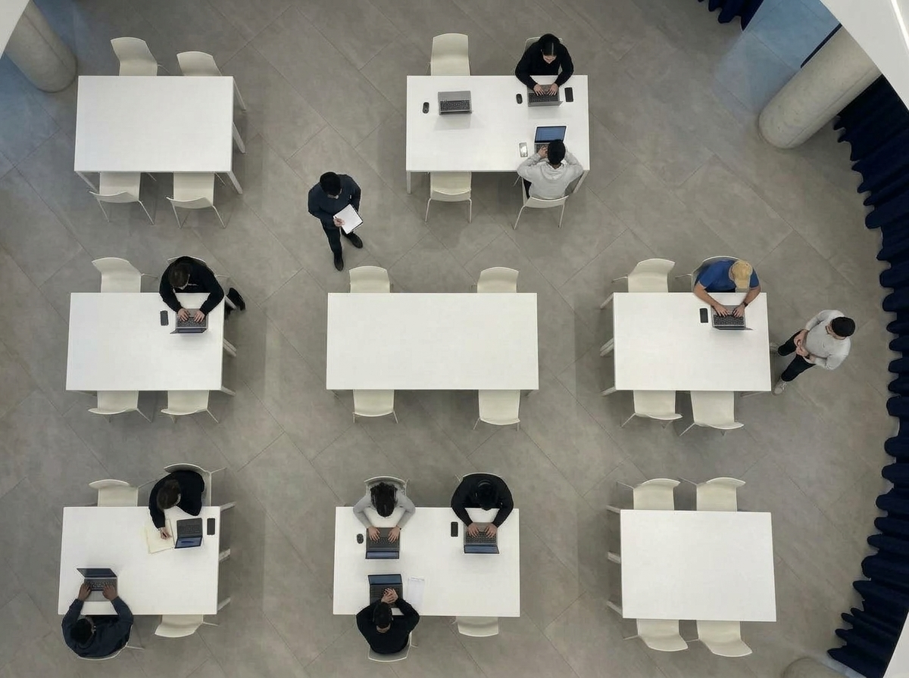

# SeatFinder: Study Room Seat Detector

Detects how many people sit at each table of a study room from an overhead camera photo, so students can see which tables are free.

## What the code does

1. Loads an overhead photo of the room.
2. YOLO finds every person in the photo (one pass).
3. The room has 8 tables, each defined by a rectangle. The code checks which rectangle the center of each person falls into.
4. It counts the people at each table and prints the result, for example `Total people detected on table 1: 2`.
5. It shows the photo with a green dot on each person and a red rectangle around each table.

## Files

| File | What it is |
|------|------------|
| `main_program.py` | The detection program |
| `utils.py` | Helper functions |
| `images/` | Photos we use to test the project, and result screenshots |
| `requirements.txt` | Libraries to install |

## Install

You need Python 3.8 or newer. Open a terminal inside this folder and run:

```
pip install -r requirements.txt
```

The first run also downloads the YOLO model automatically (needs internet once).

## Images

We test the project with the photos in the `images/` folder. The code loads one like this:

```python
img = cv2.imread("./images/1.jpg")
```

To try another photo, change the file name (`1.jpg`, `2.jpg`, `3.jpg`). Run the program from inside the repo folder, so the `images/` folder is found.

The table rectangles are set for one camera angle, so use photos taken from the same position.

### Test images





## Run

```
python main_program.py
```

Press any key to close the result window.

## Example result

Green dots are detected people, and red rectangles are the table zones.


The terminal prints how many people are at each table:


